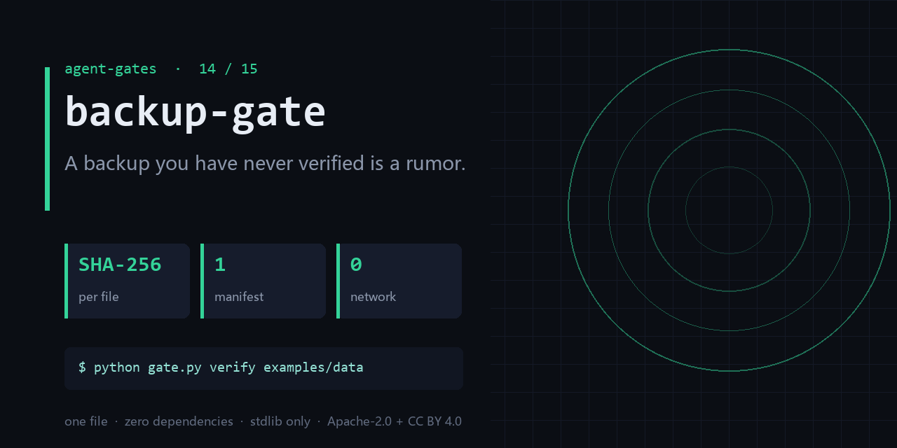

<div align="center">

</div>

<h1 align="center">backup-gate</h1>

<p align="center"><b>A backup you have never verified is a rumor.</b><br><sub>one file · zero dependencies · stdlib only</sub></p>

<p align="center"><a href="https://github.com/chenhz01/backup-gate/actions/workflows/gate.yml"></a>   </p>

---

## The failure this catches

- You assumed there was a backup; at restore time the manifest was six months old and half the files were gone.
- The backup job has been green for three years and has never once been restored.
- Files changed, hashes no longer match the manifest, and nobody ever compared them.

One command, on a file you already have:

```bash
python gate.py manifest examples/data && \
  python gate.py verify examples/data
```

<details>
<summary><b>Real output</b> — produced by the bundled <code>examples/</code>, not a mock-up</summary>

```text
backup-gate report
================================
ERROR  ledger.csv                   size-mismatch      size 29 != manifest 22
summary: declared=2 on_disk=2 missing=0 extra=0 mismatch=1 errors=1 warnings=0
verdict: FAIL: 1 integrity error(s)
```

</details>

## What it does

- Builds a SHA-256 manifest, then verifies content, presence, and freshness.
- Reports exact mismatched and missing paths — not just a count.
- Text or JSON; cheap enough to run nightly.

## What it does **not** do

- It is a verifier, not a backup tool. It does not copy anything anywhere.
- Freshness checks the manifest age, not whether the data is *correct*.
- No offsite, no encryption, no retention policy — pair it with a real backup system.

Being explicit here is cheaper than a wrong expectation later.

## Exit codes

`0` = clean, `1` = findings. Gate your pipeline on `$?`.

## Install

```bash
git clone https://github.com/chenhz01/backup-gate
cd backup-gate
python gate.py --help
```

Python 3.9+. Nothing to `pip install` — stdlib only.

## Use it in CI

```yaml
- name: backup-gate
  run: python gate.py verify examples/data
```

## Use it as a GitHub Action

`action.yml` is included, so you can call this repo directly as a composite action.

```yaml
# .github/workflows/gates.yml
- uses: actions/checkout@v4

- uses: chenhz01/backup-gate@v0.1.0
  with:
    # IMPORTANT: this path is inside YOUR repository.
    # The examples/ in this repo are NOT in your workspace — pass your own files.
    args: "verify path/to/data"
```

Pin the tag (`@v0.1.0`) rather than `@main` — `main` moves.

If you omit `args`, the action only prints help and exits 0. It raises a warning
annotation so a green check is never mistaken for "it inspected my files".


## 中文速览

**备份门** — 没有验证过的备份，只是一个传闻。

- 以为有备份，真要用时发现清单是半年前的，还少了一半文件。
- 备份任务绿了三年，没人试过一次还原。
- 文件被人改过，哈希值和清单对不上，但没人比对过。

一行命令：`python gate.py verify examples/data`

边界：It is a verifier, not a backup tool. It does not copy anything anywhere.

## The gates

| # | gate | what it stops |
|---|---|---|
| 02 | **[loop-gate](https://github.com/chenhz01/loop-gate)** | Find where your agent looped, before it burns another run |
| 03 | **[permission-gate](https://github.com/chenhz01/permission-gate)** | Score how much more your agent can do than it should |
| 04 | **[context-gate](https://github.com/chenhz01/context-gate)** | Measure what truncation deletes, before the model starts guessing |
| 05 | **[instruction-gate](https://github.com/chenhz01/instruction-gate)** | Two of your instructions contradict each other. This finds them |
| 06 | **[output-gate](https://github.com/chenhz01/output-gate)** | Before AI-written text ships, run the four checks it always fails |
| 07 | **[memory-expiry-gate](https://github.com/chenhz01/memory-expiry-gate)** | Give every memory a TTL, then prove the expiry semantics actually hold |
| 08 | **[drift-gate](https://github.com/chenhz01/drift-gate)** | When embeddings drift, retrieval quietly rots. Fingerprint it |
| 09 | **[price-gate](https://github.com/chenhz01/price-gate)** | Your cost model is only as good as the price table under it |
| 10 | **[complexity-ceiling](https://github.com/chenhz01/complexity-ceiling)** | Per-file complexity budgets that fail the build instead of the reviewer |
| 11 | **[deadcode-gate](https://github.com/chenhz01/deadcode-gate)** | Quantify how much of the repo is dead, instead of guessing |
| 12 | **[docrot-gate](https://github.com/chenhz01/docrot-gate)** | Docs don't die at once. They rot one stale command at a time |
| 13 | **[leak-gate](https://github.com/chenhz01/leak-gate)** | Scan for internal detail before the doc leaves the building |
| 14 | **backup-gate** ← you are here | A backup you have never verified is a rumor |
| 15 | **[trail-gate](https://github.com/chenhz01/trail-gate)** | Hash-chained agent audit trail — and it verifies its own chain |

## License

- Code: **Apache-2.0** — see [LICENSE](LICENSE)
- Docs and example data: **CC BY 4.0** — see [LICENSE-SPEC](LICENSE-SPEC)

Attribution required when you redistribute the documentation; code can be used commercially
without a separate agreement. See [NOTICE](NOTICE).
